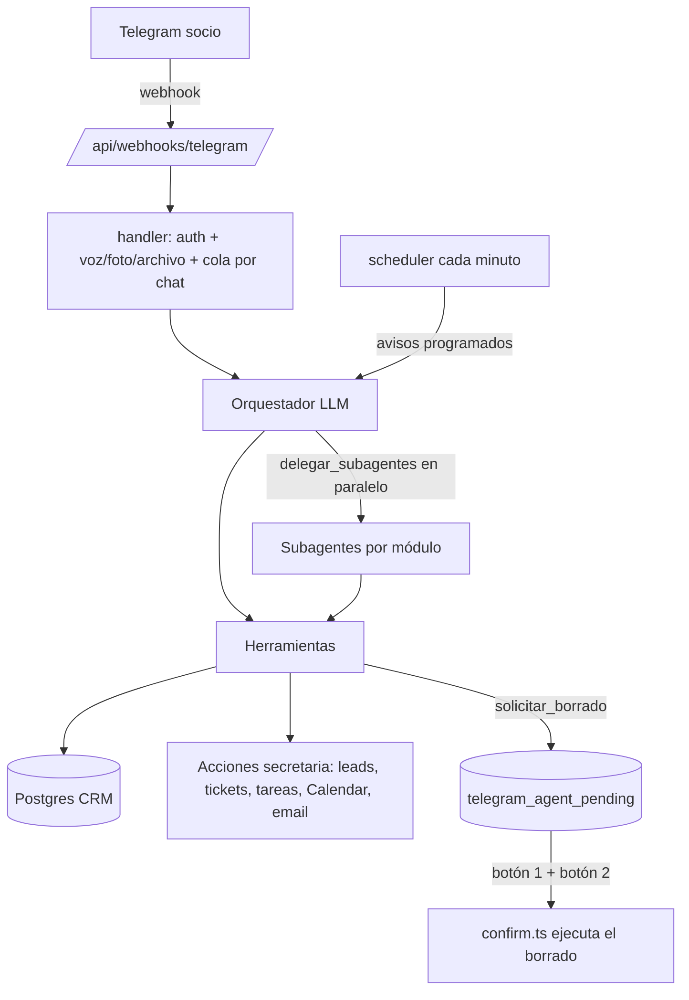

# Agente de Telegram del CRM

Los socios pueden hacer cualquier cosa del CRM desde Telegram: consultar, crear,
cambiar, configurar y borrar (con doble confirmación). El agente también manda
los avisos programados que le pidáis.

## Activar

1. En EasyPanel, en el servicio del CRM, añadir:
   - `TELEGRAM_AGENT=1`
   - (ya existen) `TELEGRAM_BOT_TOKEN`, `TELEGRAM_CHAT_IDS`, `OPENROUTER_API_KEY`, `NEXT_PUBLIC_BASE_URL`
2. Reiniciar el servicio y abrir el CRM en el navegador: al arrancar, el bot se
   apunta solo a `{APP_BASE_URL}/api/webhooks/telegram` y crea sus tablas.
   - También se puede forzar logueado como admin: `POST /api/telegram/setup`
     (y `GET` para ver el estado).
3. Escribir `/ayuda` al bot.

> Si el mismo bot estaba conectado a n8n u otro sistema que lee sus mensajes
> (webhook o `getUpdates`), dejará de recibirlos: Telegram solo admite un
> receptor por bot. Los avisos que manda el CRM no se ven afectados.

## Quién tiene acceso

Solo los IDs de `TELEGRAM_CHAT_IDS` (los mismos que reciben los avisos) más
`TELEGRAM_AGENT_USER_IDS` si se definen. Cualquier otra persona recibe
«No tienes acceso» y su ID. En grupos de avisos, el agente solo contesta si le
mencionan, le responden o es un comando. El acceso no se puede cambiar desde el
chat (a propósito): solo en las variables del servidor.

El webhook comprueba la cabecera secreta de Telegram (`TELEGRAM_WEBHOOK_SECRET`
o una derivada del token), así que nadie puede suplantar mensajes.

## Arquitectura

| Archivo | Rol |
|---|---|
| `lib/telegram-agent/config.ts` | Activación, socios autorizados, modelos |
| `lib/telegram-agent/handler.ts` | Entrada de mensajes, comandos, entrega de respuestas |
| `lib/telegram-agent/agent.ts` | Orquestador y subagentes (prompts) |
| `lib/telegram-agent/modules.ts` | Los 8 módulos: tablas, herramientas y guía |
| `lib/telegram-agent/tools.ts` | Herramientas y auditoría de cada cambio |
| `lib/telegram-agent/db-tools.ts` | Acceso a la base de datos |
| `lib/telegram-agent/confirm.ts` | Doble confirmación de borrados |
| `lib/telegram-agent/scheduler.ts` | Webhook automático y avisos programados |

### Subagentes

`comercial`, `coldcalling`, `marketing`, `proyectos`, `finanzas`, `soporte`,
`agenda`, `sistema`. Cada uno tiene su prompt, las tablas de su área, sus
herramientas de alto nivel y acceso completo a la base de datos. El orquestador
puede lanzar hasta 6 a la vez.

## Doble confirmación de borrados

El modelo **nunca** borra. `solicitar_borrado` / `solicitar_sql_destructivo`
solo guardan la petición con un preview (filas que coinciden y una muestra).
Después el bot manda un mensaje con botones:

1. «🗑 Sí, eliminar» → el mensaje cambia a la confirmación final.
2. «🔴 ELIMINAR DEFINITIVAMENTE» → se ejecuta en una transacción.

- Escribir «sí» no sirve: hacen falta los dos botones.
- Caduca a los 15 minutos.
- Si al ejecutar coinciden más filas que en el preview, se aborta sin borrar.
- Cada paso es atómico en BD (dos pulsaciones a la vez no ejecutan dos veces).

## Configurar desde el chat

- Instrucciones permanentes: «a partir de ahora los importes siempre con IVA» →
  `telegram_agent_instructions` (opcionalmente solo para un módulo).
- Avisos: «recuérdame el viernes a las 10 llamar a X», «cada lunes a las 9
  mándame los cobros pendientes» (tipo tarea: el agente lo calcula y lo envía).
- Todo lo demás del CRM (usuarios, demos, pipelines, objetivos…) está en la base
  de datos y el agente lo puede cambiar.

## Comandos

`/ayuda` · `/nuevo` (olvida la conversación) · `/pendientes` · `/avisos` ·
`/instrucciones` · `/id`

## Registro

Cada cambio queda en `telegram_agent_audit` (quién, qué herramienta, argumentos
y resultado). Se le puede preguntar al agente «¿qué has cambiado hoy?».
